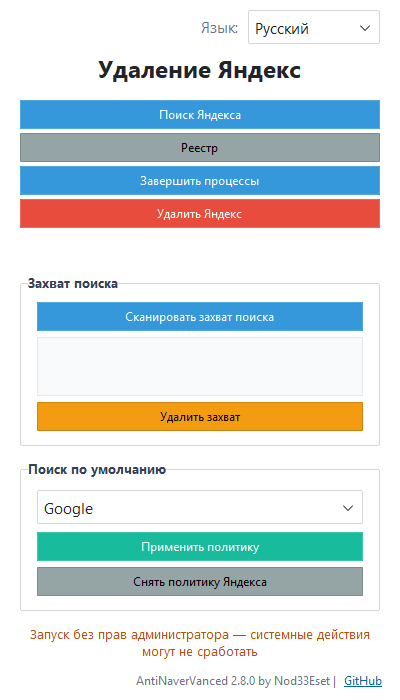

# AntiNaver Vanced

[](https://github.com/retvil/AntiNaverVanced/releases) [](https://github.com/retvil/AntiNaverVanced/releases) [](https://www.python.org/)

**Supprime complètement Naver Browser et verrouille ta recherche par défaut contre le détournement — 40 vecteurs de détection, 10 moteurs de recherche, 10 langues d'interface.**

[🇬🇧 English](README.md) | [🇷🇺 Русский](README.ru.md) | [🇺🇦 Українська](README.uk.md) | [🇰🇿 Қазақша](README.kk.md) | [🇩🇪 Deutsch](README.de.md) | **🇫🇷 Français** | [🇪🇸 Español](README.es.md) | [🇵🇱 Polski](README.pl.md) | [🇹🇷 Türkçe](README.tr.md) | [🇨🇳 中文](README.zh.md)

## Qu'est-ce que c'est ?

Naver n'installe pas qu'un navigateur — il s'enregistre silencieusement comme recherche et navigateur par défaut via quarante mécanismes système : associations dans le registre, politiques d'entreprise, paramètres de profils de navigateurs, même les bases de données de moteurs de recherche dans les profils Chromium. Supprimer le navigateur seul ne suffit pas.

**AntiNaver Vanced** (un fork de [TheCawa/AntiNaver](https://github.com/TheCawa/AntiNaver)) trouve **les 40 vecteurs de détournement**, les supprime en un clic, puis **verrouille ta recherche par défaut** sur le moteur de ton choix via les politiques d'entreprise Windows — pour que rien ne puisse la reprendre silencieusement.

## Fonctionnalités

- **Scanner de détournements** — détecte 40 vecteurs : chemins d'installation, entrées Uninstall du registre, association `UserChoice`, enregistrements `StartMenuInternet`, arbres de clés `Software\Naver`, détournement via les politiques `DefaultSearchProvider*`, `Preferences` des profils Chromium, mots-clés dans `Web Data` (SQLite), `search.json.mozlz4` Firefox, `SearchScopes` legacy, entrées d'autostart, tâches planifiées, services Windows, IME Switcher, associations de fichiers, intégration shell de Naver Disk, autostart désactivé, App Paths, raccourcis, restes ProgramData/Roaming, entrées hosts, règles de pare-feu, protocoles URI, extensions de navigateur, cookies naver.ru, associations « Ouvrir avec », traces Prefetch/WER, exclusions Defender, dispositions clavier, détournement de la page de démarrage IE, politiques d'URL de démarrage (`RestoreOnStartupURLs`), page d'accueil Firefox, zone map IE, entrées RegisteredApplications, traces MUICache, programmes d'installation dans %TEMP%, applications Store (Naver Music, Alice), répertoires de produits, répertoires de données locales, Naver.DNS
- **Suppression en un clic** — chaque vecteur a son propre remover ; les bases verrouillées sont signalées honnêtement, sans crash
- **Politique stricte de recherche** — verrouille la recherche par défaut sur l'un des 10 moteurs (Google, Bing, DuckDuckGo, Brave Search, Startpage, Mojeek, Qwant, Ecosia, Yahoo, SearXNG) via les politiques HKLM pour Chrome, Edge, Brave, Vivaldi, Opera et Naver Browser + `policies.json` pour Firefox/Waterfox
- **Nettoyage des politiques** — purge les valeurs `DefaultSearchProvider*` de Naver du registre
- **10 langues d'interface** — ru, en, uk, kk, de, fr, es, pl, tr, zh ; langue du système détectée automatiquement
- **Interface légère** — ttkbootstrap, disposition verticale, barre d'état et pied de page fixés

## Capture d'écran

<details>
<summary>Fenêtre principale</summary>



</details>

## Builds prêts à l'emploi

Téléchargez depuis [Releases](https://github.com/retvil/AntiNaverVanced/releases) :

- **Windows** — `AntiNaverVanced.exe` (portable, fichier unique, ~35 Mo) — supprime Naver Browser et Naver Search
- **Windows** — `AntiNaverExtended.exe` (portable, fichier unique, ~35 Mo) — suppression de tous les produits Naver (Naver Disk, historique IME Switcher, traces système, applications Store, Naver.DNS)

Lancez-le **en tant qu'administrateur** — les politiques HKLM et le nettoyage du registre exigent des droits élevés.

## Installation depuis les sources

Python 3.10+ requis ([python.org](https://python.org)).

```bash
git clone https://github.com/retvil/AntiNaverVanced.git
cd AntiNaverVanced
pip install psutil ttkbootstrap
python main.py
```

Compiler votre propre EXE : lancez `build.bat` (PyInstaller, résultat dans `dist/`).

## Utilisation

1. **Terminer les processus** → **Rechercher Naver** → **Supprimer Naver** — on retire le navigateur lui-même.
2. **Scanner les détournements** — liste toutes les façons dont Naver s'est enraciné dans le système.
3. **Supprimer les détournements** — fermez d'abord tous les navigateurs, puis retirez tout ce qui est trouvé.
4. Choisissez un moteur → **Appliquer la politique** — la recherche par défaut est verrouillée au niveau du système.

## FAQ

- **Pourquoi administrateur ?** Les politiques de recherche vivent dans HKLM, le nettoyage touche le registre système — droits élevés requis.
- **« Database locked » dans les résultats ?** Un navigateur Chromium tournait pendant le nettoyage. Fermez tous les navigateurs et relancez la suppression.
- **Comment retirer la politique de recherche ?** Le bouton **Supprimer les politiques Naver** purge les valeurs ; dans Firefox, vous pouvez aussi supprimer le fichier `distribution\policies.json`.

## Auteur & support

**Nod33Eset** — fork de [TheCawa/AntiNaver](https://github.com/TheCawa/AntiNaver). Issues et PR bienvenues.

Si l'outil t'a débarrassé de Naver, tu peux soutenir le développement :

**Crypto :**

- BTC : `bc1qunld3rsp37qf5gg69aune50y0qqkd0eugg7j97`
- TON : `UQDmvr4SKOxSION3Yky6aOgzAnCDXySPuAbG4EKJa5JUT7tC`
- USDT (TRC20) : `TBPJSSLu1mUcX54g9UyxUohYGf2fuRvbwd`
- USDT (ERC20) : `0x25CAED3776Ef5b18E03392bC5b254Bbd78E8180C`
- USDT (SOL) : `3qgN5z291CEcj2FUi2Zza5DioxKgNw72kC7P52pCcTrG`

## Licence

MIT — voir [LICENSE](LICENSE).
